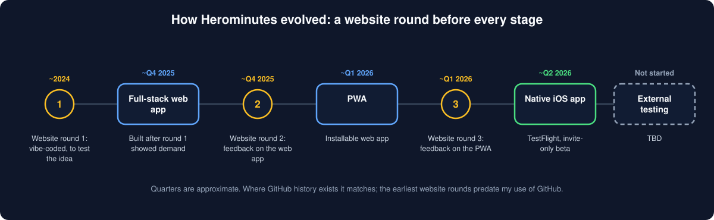
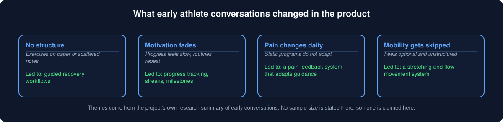
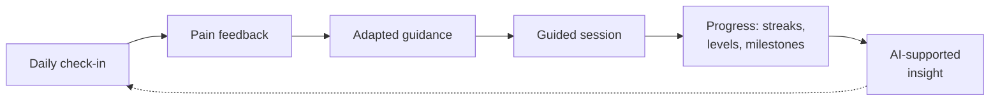
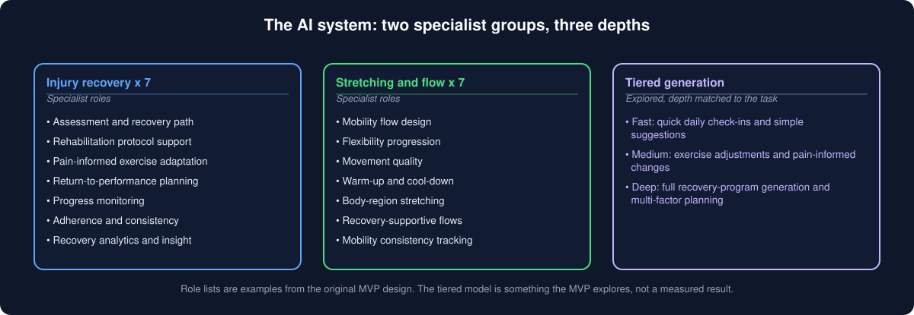
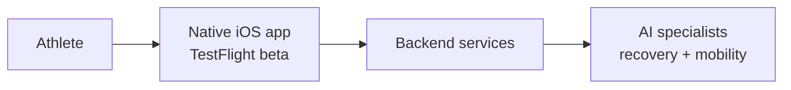

# Herominutes

**An AI-fitness training system that adapts to how you feel.**

Herominutes asks how you feel, writes today's session around your answer, and adjusts as your discomfort, readiness and sessions change. It began as an injury recovery and mobility platform for athletes, and that remains one of its journeys.

> **Not medical advice.** Herominutes is a product prototype, not a medical service. It does not diagnose, treat or replace a licensed clinician. Check with a qualified professional before starting a recovery program. See the [medical disclaimer](https://www.herominutes.com/legal/medical-disclaimer.html).

---

## Training journeys

As described on [herominutes.com](https://www.herominutes.com):

- **Comeback:** training around something that has been bothering you, in five phases (Protect, Reload, Rebuild, Perform, Elite).
- **Desk Reset:** four phases of undoing what sitting all day does, and building back strength.
- **Also:** Flexibility & Flow, Maintenance, and Breathwork & Meditation.
- **A short daily check-in** shapes each session, and you move up on your own numbers, not on a calendar.
- **A stop rule:** if what you report looks like it needs a doctor or physical therapist, the app stops and says so.

---

## Core Features

Herominutes is designed around several core product capabilities that support athletes throughout the injury recovery journey.

### AI-Powered Recovery Programs
Personalized injury recovery programs generated using a multi-specialist AI system designed to guide athletes safely through rehabilitation.

### Stretching & Mobility Flows
Guided stretching and mobility routines designed to improve flexibility, reduce stiffness, and support long-term recovery.

### Pain Feedback System
Daily pain check-ins allow the platform to adapt exercises and recovery guidance based on how the athlete feels.

### Gamified Recovery Progress
Streaks, leveling systems, and progress milestones help athletes stay consistent with rehabilitation routines.

### Adaptive AI Guidance
Herominutes explores tiered AI generation that adjusts the depth of recommendations based on user progression and recovery complexity.

---

## Try it

The app is an iOS app in an invite-only TestFlight beta. Request an invite at [herominutes.com/join](https://www.herominutes.com/join). The demo post is not ready yet.

---

## How it evolved

Herominutes started in 2024 and has moved to a new platform each time the product earned it. Before each stage I put a website in front of people to get feedback on the current product and decide where to go next. Across three website rounds, the feedback and conversations showed positive demand and made the next direction clearer.

Quarters are approximate. Where GitHub history exists it matches: the full-stack web app's first commits are from December 2025 and the iOS app's first commit is from June 2026. The earliest website rounds predate my use of GitHub. The first website rounds were built quickly with AI coding tools ("vibe coding"); the product decisions, interviews and conversations with users were mine.

---

## Overview

Herominutes is a native iOS app, currently in an invite-only TestFlight beta: an AI-fitness training system that adapts to how you feel, including structured recovery and mobility routines for athletes. It started as a progressive web app (PWA) MVP and is no longer a PWA.

The platform combines structured recovery workflows, progress tracking, and AI-supported guidance to help users stay consistent and informed throughout the recovery process.

The MVP focuses on two primary user needs:

• Injury Recovery — structured recovery workflows for athletes returning from injury  
• Stretching & Mobility — guided routines that improve flexibility, movement quality, and injury prevention

Herominutes explores how AI and multi-agent systems can make recovery more personalized, adaptive, and consistent.

---

## Problem

Athletes recovering from injury often face fragmented recovery experiences:

• exercises scattered across notes or rehab sheets  
• inconsistent recovery tracking  
• lack of structured recovery workflows  
• generic rehabilitation guidance  
• low adherence to recovery programs

Without clear structure and feedback, recovery can become slow, inconsistent, and frustrating.

---

## Solution

Herominutes provides a structured recovery system designed to guide athletes through daily recovery and mobility workflows.

The platform helps users:

• follow structured recovery routines  
• track recovery progress over time  
• maintain consistency in mobility and rehabilitation exercises  
• receive AI-supported insights during recovery

The system is designed to support athletes throughout the entire recovery journey, from early rehabilitation through return-to-performance readiness.

---

## The Recovery Loop

## Core Features

• injury recovery workflows  
• stretching and mobility guidance  
• daily recovery check-ins  
• exercise and mobility library  
• athlete progress dashboards  
• AI-supported recovery insights  
• native iOS experience, in TestFlight

---

## Multi-Agent System (MVP Architecture)

The Herominutes MVP explores a 7-agent architecture designed to support different parts of the athlete recovery experience.

Example agent roles include:

• recovery workflow guidance  
• mobility and stretching support  
• progress monitoring  
• recovery insights and recommendations  
• workout adaptation support  
• user feedback interpretation  
• recovery consistency support

The goal of the multi-agent system is to provide context-aware recovery guidance that adapts to the athlete's needs over time.

---

## Architecture (High-Level)

> The diagram is deliberately high-level. The text block below it describes the original web MVP. The native iOS app's stack is not documented in this repository yet.

Athlete User  
↓  
React Progressive Web App (Client)  
↓  
API Layer  
↓  
Supabase Database  
↓  
AI-Supported Recovery Logic

---

## Status

Native iOS app in an invite-only TestFlight beta. Active development.

- **My role:** solo entrepreneur and AI builder.
- **Timeline:** started in 2024, from my own injury, an idea brainstorm, and interviews and discussions with users.

The current MVP focuses on validating recovery workflows, mobility routines, and AI-supported recovery insights.

---

## Repository Note

This public repository is a product overview only. The production code and the detailed internal documents (strategy, pricing, requirements and roadmap) are private, because the product is still pre-launch.

---

## Vision

Herominutes explores how AI-native product design can improve real-world recovery experiences for athletes and help individuals return to performance faster, safer, and with greater confidence.

---

## Tech Stack (original web MVP)

The original MVP was built as a full-stack progressive web application. The native iOS app's stack is not documented in this repository yet.

Frontend
• React  
• TypeScript  
• TailwindCSS  
• Progressive Web App (PWA)

Backend
• Node.js  
• Express

Infrastructure
• Supabase (Postgres, Auth, Storage)

AI System
• Multi-specialist AI architecture  
• Tiered generation (fast / medium / deep reasoning)

---

## License & intellectual property
### Copyright © 2026 Jamil H. (Hero Minutes). All rights reserved.

This repository and everything in it, the product overview, graphics and written content, is the original work of the repository owner. It is published to demonstrate a product-thinking methodology, from user research through product strategy and AI system design, and to start conversations with hiring managers, collaborators and potential co-founders.

This is not open-source software. Publication on GitHub does not transfer any intellectual property rights. You may view, study, and reference this work for educational and non-commercial purposes with attribution. You may not use this content, the product architecture, AI system design or product strategy in any commercial product or service without a separate written agreement with the author.

If you would like to collaborate or discuss this work, reach out directly.

